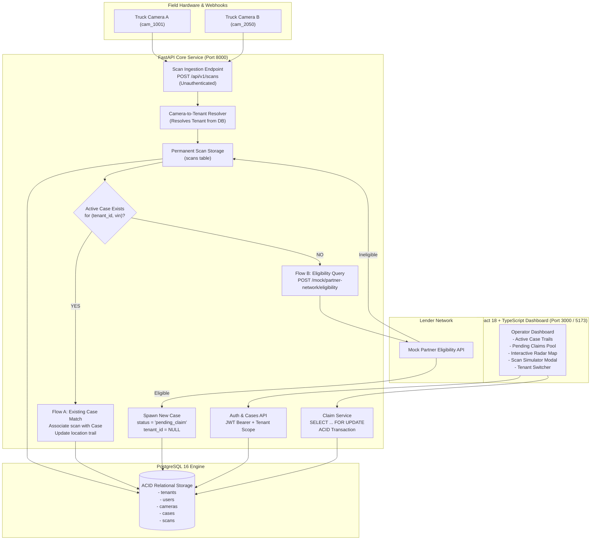
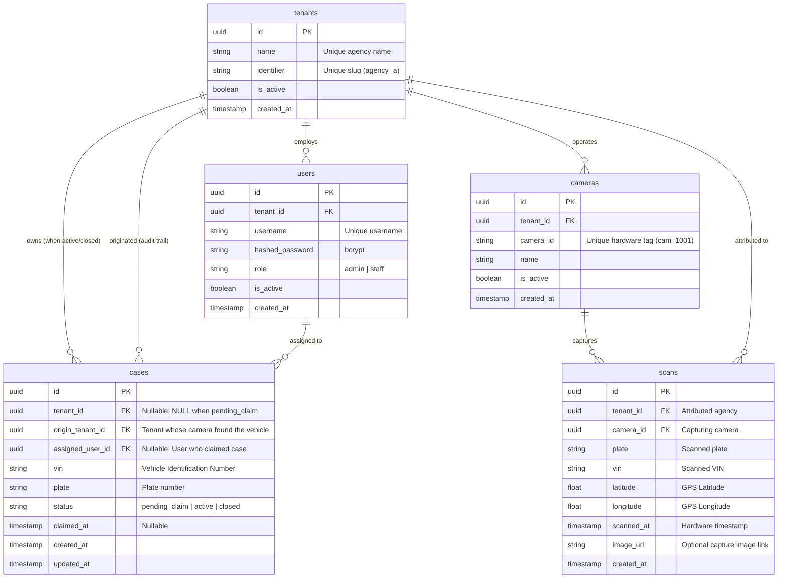

# Plate Scan & Case Matching Service

A full-stack, multi-tenant License Plate Recognition (LPR) ingestion and repossession case-matching platform designed for vehicle-recovery agencies.

Truck-mounted LPR cameras continuously capture vehicle license plates and Vehicle Identification Numbers (VINs) on road routes. The platform attributes unauthenticated camera scans to the owning recovery agency, matches scans against active repossession cases to establish real-time GPS location trails (**Flow A**), or coordinates with lender partner networks to evaluate repossession eligibility and create claimable opportunities (**Flow B**).

---

## 1. Overview

In the vehicle recovery and repossession industry, recovery agencies operate fleets of spotter and tow vehicles outfitted with automated License Plate Recognition (LPR) cameras. As these vehicles navigate public roadways and parking facilities, cameras continuously stream plate captures and VIN readings to a central system.

This platform solves three critical operational challenges:
1. **High-Throughput Hotlist Matching (Flow A):** Instantly matches incoming plate/VIN scans against open recovery orders (cases) belonging to the camera's agency, updating the vehicle's chronological location trail.
2. **Autonomous Opportunity Discovery (Flow B):** When a scanned vehicle does not have an active case within the scanning agency, the system automatically checks lender eligibility. If repossession is authorized, a new `pending_claim` case is generated.
3. **Cross-Agency Claims Market:** Recovery agencies can monitor a shared pool of `pending_claim` cases. Any verified agency can claim an open case on a first-come, first-served basis, transitioning it to their active queue with strict row-level concurrency protection.

> **Project Scope:** This repository is an interview-ready, full-stack case study implementation. It emphasizes robust backend business logic, multi-tenant data isolation, ACID transaction safety, clean API contracts, and an intuitive operator dashboard.

---

## 2. Key Features

- **FastAPI REST API:** Python 3.12+, async request handling, Pydantic V2 validation, SQLAlchemy 2.0 ORM, and dependency-injected services.
- **Strict Multi-Tenant Security:** Tenant boundaries enforced at the database and repository layer using JWT authentication and tenant-scoped queries. Tenant A can never view or manipulate Tenant B's active or closed cases.
- **Hardware-Derived Tenant Attribution:** The `POST /api/v1/scans` ingestion webhook is intentionally unauthenticated; tenant authority is resolved exclusively from the registered `camera_id`, completely ignoring any spoofed tenant IDs in payloads.
- **Guaranteed Scan Retention:** Every scan is permanently persisted to the database upon arrival—regardless of whether it matches an existing case, spawns a new case, or is deemed ineligible.
- **Row-Level Concurrency Defense:** Concurrent claims on the same pending case are guarded by database-level transactions using `SELECT ... FOR UPDATE`, guaranteeing that only one claimant wins and late claimants receive `409 Conflict`.
- **Mock Partner Eligibility Service:** Simulates lender partner networks (`POST /mock/partner-network/eligibility`) with deterministic fallback rules and network resilience.
- **Production React Dashboard:** React 18, TypeScript, and Vite with responsive Tailwind CSS, an interactive SVG radar map visualizer, real JWT session switching, and an interactive scan ingestion simulator modal.
- **Comprehensive Test Suite:** 41 automated Pytest tests validating security isolation matrices, scan flows, race conditions, and API schemas (100% pass rate).
- **Containerized Deployment:** Multi-stage Dockerfiles and Docker Compose configuration for PostgreSQL, FastAPI backend, and Nginx-powered frontend.

---

## 3. Architecture



---

## 4. Core Business Flows

### Flow A — Existing Case (Hotlist Sighting)
```
Camera Scan Ingest ──> Resolve Camera's Tenant ──> Persist Scan (DB)
                                                          │
             ┌────────────────────────────────────────────┘
             ▼
Query Active Case for (tenant_id, vin)
             │
             ├──> [ACTIVE CASE FOUND]
             │         │
             │         ▼
             │    Associate Scan with Case
             │    Update chronological sighting trail
             │    Return matched_existing_case = true
```
1. An unauthenticated scan arrives via `POST /api/v1/scans` with `camera_id`, `plate`, `vin`, coordinates, and timestamp.
2. The system queries the `cameras` table to resolve the camera's registered recovery agency (`tenant_id`). If the camera is unknown or inactive, the request is rejected immediately (`404` or `400`).
3. **The scan is unconditionally saved** to the `scans` table.
4. The service queries for an existing case where `tenant_id = camera.tenant_id`, `vin = scan.vin`, and `status = 'active'`.
5. Since an active case exists, the scan is linked to the case history. The scan immediately appears in the case's chronological location trail (`GET /api/v1/cases/{case_id}/scans`).
6. Response returns `matched_existing_case = true`, `created_new_case = false`.

---

### Flow B — New Case (Repo-Eligible Discovery)
```
Camera Scan Ingest ──> Resolve Camera's Tenant ──> Persist Scan (DB)
                                                          │
             ┌────────────────────────────────────────────┘
             ▼
Query Active Case for (tenant_id, vin)
             │
             └──> [NO ACTIVE CASE FOUND]
                       │
                       ▼
             Call Mock Partner Eligibility API
                       │
                       ├──> [ELIGIBLE] ──> Create Case (status='pending_claim', tenant_id=NULL)
                       │                    Return created_new_case = true
                       │
                       └──> [INELIGIBLE] ─> Scan retained in DB. No case created.
```
1. An incoming scan arrives for a VIN that has **no active case** under the camera's tenant.
2. The scan is unconditionally saved to the database.
3. The platform invokes the external lender eligibility service (`POST /mock/partner-network/eligibility`).
4. **If eligible:**
   - A new record is created in `cases` with `status = 'pending_claim'`.
   - `origin_tenant_id` records the sighting agency for auditing and scan linkage.
   - `tenant_id` and `assigned_user_id` remain `NULL` (unassigned).
   - The pending case is immediately visible in the global pending claims pool across all agencies.
5. **If ineligible:**
   - The scan remains safely archived in the `scans` table for future intelligence.
   - No case is spawned (`created_new_case = false`).

---

### Cross-Tenant Claiming & Race Condition Defense
```
Agency A Worker                      PostgreSQL Transaction Engine                      Agency B Worker
      │                                           │                                           │
      ├───── POST /api/v1/cases/{id}/claim ──────>│                                           │
      │                                           │<───── POST /api/v1/cases/{id}/claim ──────┤
      │                                           │                                           │
      │      [BEGIN TRANSACTION]                  │                                           │
      │      SELECT * FROM cases                  │                                           │
      │      WHERE id = :id                       │                                           │
      │      FOR UPDATE;                          │                                           │
      │      ──> Row Lock Acquired                │      [BEGIN TRANSACTION]                  │
      │                                           │      SELECT * FOR UPDATE                  │
      │      Verify status == 'pending_claim'     │      ──> BLOCKED ON ROW LOCK              │
      │      Update status = 'active'             │             :                             │
      │      Update tenant_id = Tenant A          │             :                             │
      │      Update assigned_user_id = User A     │             :                             │
      │      [COMMIT]                             │             :                             │
      │                                           │             :                             │
      │<──── HTTP 200 OK (Claimed) ───────────────┤             :                             │
      │                                           │      ──> Lock Released & Acquired         │
      │                                           │      Verify status == 'pending_claim'     │
      │                                           │      ──> FAILS: status is 'active'        │
      │                                           │      [ROLLBACK]                           │
      │                                           │                                           │
      │                                           ├───── HTTP 409 Conflict ──────────────────>│
      │                                           │      ("Case already claimed")             │
```

- When multiple users attempt to claim the same pending case simultaneously, the backend utilizes **Pessimistic Row-Level Locking** (`with_for_update()`).
- The first transaction locks the row, verifies that `status == 'pending_claim'`, assigns tenant ownership, sets `status = 'active'`, and commits.
- Subsequent transactions unblock, detect that `status != 'pending_claim'`, abort the transaction, and raise an `HTTP 409 Conflict` exception.
- A database-level partial unique index (`uq_tenant_active_vin`) prevents any tenant from holding duplicate active cases for the same VIN.

---

## 5. Multi-Tenant Security & Isolation Matrix

The platform strictly isolates agency data at the API and database levels. Tenant authorization is derived from the verified JWT access token, never from client-provided headers or payload fields.

| Request / Action | Tenant A User | Tenant B User | Expected HTTP Code | Notes |
| :--- | :--- | :--- | :--- | :--- |
| **View Tenant A Active Case** | Allowed | **Blocked** | `200 OK` vs `403 Forbidden` | Case details and sighting trail hidden from rival agencies. |
| **View Tenant A Closed Case** | Allowed | **Blocked** | `200 OK` vs `403 Forbidden` | Historical repo records remain confidential. |
| **List Cases (Default)** | Tenant A cases + all `pending_claim` | Tenant B cases + all `pending_claim` | `200 OK` | Rival active/closed cases are filtered out at the SQL query level. |
| **View `pending_claim` Case** | Allowed | Allowed | `200 OK` | Pending cases form a global opportunity marketplace. |
| **View Scans for `pending_claim`** | Allowed | Allowed | `200 OK` | Sighting locations visible to evaluate recovery feasibility. |
| **Claim `pending_claim` Case** | Allowed (if 1st) | Allowed (if 1st) | `200 OK` (1st) / `409 Conflict` (2nd) | Winning claimant assumes exclusive ownership. |
| **View Claimed Case (Post-Claim)** | Allowed | **Blocked** | `200 OK` (Owner) / `403 Forbidden` (Rival) | Once claimed by A, B loses all visibility. |

---

## 6. Database Schema & Entity Relationships

The schema is managed via **Alembic** migrations and enforces referential integrity, check constraints, and partial unique indexes.



### Critical Indexes & Constraints
1. **`uq_tenant_active_vin`**: Partial unique index on `cases(tenant_id, vin)` WHERE `status = 'active'`. Prevents an agency from accidentally opening duplicate active cases on the same VIN.
2. **`ix_scans_vin_scanned_at`**: Composite index on `scans(vin, scanned_at ASC)`. Enables sub-millisecond retrieval of chronological sighting trails.
3. **`ix_cases_status_tenant_id`**: Composite index on `cases(status, tenant_id)`. Optimizes the multi-tenant case listing query.
4. **`uq_cameras_camera_id`**: Unique constraint on `cameras(camera_id)` ensuring fast O(1) hardware-to-tenant resolution.

---

## 7. API Reference

All protected endpoints require an `Authorization: Bearer <JWT>` header obtained via `/api/v1/auth/login`.

### 1. Ingest Camera Scan (Hardware Webhook)
Ingests unauthenticated camera scan data. Tenant is resolved exclusively from `camera_id`.

- **Endpoint:** `POST /api/v1/scans`
- **Auth:** None (Public hardware ingestion endpoint)
- **Request:**
```bash
curl -X POST http://localhost:8000/api/v1/scans \
  -H "Content-Type: application/json" \
  -d '{
    "camera_id": "cam_1001",
    "plate": "7XYZ123",
    "vin": "1FTFW1E51NFA12345",
    "latitude": 33.7490,
    "longitude": -84.3880,
    "scanned_at": "2026-10-04T12:00:00Z",
    "image_url": "https://images.example.com/scans/cam1001_scan01.jpg"
  }'
```
- **Response (`201 Created` — Matched Existing Active Case):**
```json
{
  "scan_id": "d8e3ab42-...",
  "tenant_id": "1637ea1d-...",
  "vin": "1FTFW1E51NFA12345",
  "matched_existing_case": true,
  "created_new_case": false,
  "case_id": "0ba7e441-...",
  "case_status": "active",
  "message": "Scan recorded and matched to existing active case location trail."
}
```

---

### 2. User Authentication
Authenticates agency personnel and issues a signed JWT token containing tenant context.

- **Endpoint:** `POST /api/v1/auth/login`
- **Auth:** None
- **Request:**
```bash
curl -X POST http://localhost:8000/api/v1/auth/login \
  -H "Content-Type: application/json" \
  -d '{
    "username": "tenant_a_user",
    "password": "password123"
  }'
```
- **Response (`200 OK`):**
```json
{
  "access_token": "eyJhbGciOiJIUzI1NiIsInR5cCI6IkpXVCJ9...",
  "token_type": "bearer",
  "user": {
    "id": "a1b2c3d4-...",
    "username": "tenant_a_user",
    "tenant_id": "1637ea1d-...",
    "tenant_name": "Recovery Agency A",
    "role": "staff"
  }
}
```

---

### 3. List Cases (Tenant-Scoped)
Retrieves cases visible to the authenticated user's agency (all agency active/closed cases plus all global `pending_claim` cases).

- **Endpoint:** `GET /api/v1/cases?status=pending_claim&page=1&page_size=20`
- **Auth:** Bearer Token
- **Request:**
```bash
curl -X GET "http://localhost:8000/api/v1/cases?status=pending_claim" \
  -H "Authorization: Bearer <TOKEN>"
```
- **Response (`200 OK`):**
```json
{
  "items": [
    {
      "id": "e2f3a4b5-...",
      "tenant_id": null,
      "origin_tenant_id": "89ab12cd-...",
      "assigned_user_id": null,
      "vin": "5NPE34AF9KH123456",
      "plate": "8ABC789",
      "status": "pending_claim",
      "claimed_at": null,
      "created_at": "2026-10-04T12:05:00Z"
    }
  ],
  "total": 1,
  "page": 1,
  "page_size": 20,
  "pages": 1
}
```

---

### 4. Claim Case (Cross-Tenant Opportunity)
Claims a `pending_claim` case for the caller's agency. Guarded by pessimistic database locking.

- **Endpoint:** `POST /api/v1/cases/{case_id}/claim`
- **Auth:** Bearer Token (`staff` or `admin`)
- **Request:**
```bash
curl -X POST http://localhost:8000/api/v1/cases/e2f3a4b5-.../claim \
  -H "Authorization: Bearer <TOKEN>"
```
- **Response (`200 OK` — Success):**
```json
{
  "id": "e2f3a4b5-...",
  "tenant_id": "1637ea1d-...",
  "origin_tenant_id": "89ab12cd-...",
  "assigned_user_id": "a1b2c3d4-...",
  "vin": "5NPE34AF9KH123456",
  "plate": "8ABC789",
  "status": "active",
  "claimed_at": "2026-10-04T12:10:00Z",
  "created_at": "2026-10-04T12:05:00Z"
}
```
- **Response (`409 Conflict` — If Already Claimed):**
```json
{
  "detail": "Case e2f3a4b5-... is no longer pending claim (status: active)"
}
```

---

### 5. Get Sighting / Location Trail
Returns all historical sightings for a case's VIN, ordered chronologically.

- **Endpoint:** `GET /api/v1/cases/{case_id}/scans`
- **Auth:** Bearer Token (Caller must own the case, or case must be `pending_claim`)
- **Request:**
```bash
curl -X GET http://localhost:8000/api/v1/cases/0ba7e441-.../scans \
  -H "Authorization: Bearer <TOKEN>"
```
- **Response (`200 OK`):**
```json
[
  {
    "id": "11111111-...",
    "plate": "7XYZ123",
    "vin": "1FTFW1E51NFA12345",
    "latitude": 33.7490,
    "longitude": -84.3880,
    "scanned_at": "2026-10-04T08:00:00Z",
    "image_url": "https://images.example.com/scans/scan_01.jpg",
    "camera_id": "cam_1001",
    "camera_name": "Agency A - Truck 1"
  }
]
```

---

### 6. Mock Partner Eligibility Check
Standalone partner lender verification API.

- **Endpoint:** `POST /mock/partner-network/eligibility`
- **Auth:** None
- **Request:**
```bash
curl -X POST http://localhost:8000/mock/partner-network/eligibility \
  -H "Content-Type: application/json" \
  -d '{"vin": "5NPE34AF9KH123456"}'
```
- **Response (`200 OK`):**
```json
{
  "vin": "5NPE34AF9KH123456",
  "still_eligible_for_repo": true
}
```

---

### 7. Health Check
System liveness and database connectivity verification.

- **Endpoint:** `GET /health`
- **Auth:** None
- **Response (`200 OK`):**
```json
{
  "status": "healthy",
  "database": "connected",
  "version": "1.0.0"
}
```

---

## 8. Demo Credentials & Seed Data

The database initializes with two distinct recovery agencies, four pre-configured user accounts, and test cameras:

| Agency | Username | Password | Role | Camera ID | Initial Seed Scenario |
| :--- | :--- | :--- | :--- | :--- | :--- |
| **Recovery Agency A** | `tenant_a_user` | `password123` | Staff | `cam_1001` | Owns Active Case `1FTFW1E51NFA12345` (Ford F-150) with 3 sightings |
| **Recovery Agency A** | `tenant_a_admin` | `password123` | Admin | `cam_1001` | Agency administrator |
| **Recovery Agency B** | `tenant_b_user` | `password123` | Staff | `cam_2050` | Sights new eligible VIN `5NPE34AF9KH123456` (Hyundai Sonata) |
| **Recovery Agency B** | `tenant_b_admin` | `password123` | Admin | `cam_2050` | Agency administrator |

---

## 9. Demo Scenarios & Test Walkthroughs

### Automated End-to-End Runner
To run all three core scenarios end-to-end against the database in a single command:
```bash
cd backend
python verify_demo.py
```

### Manual Interactive Walkthrough

#### Scenario 1: Existing Case Flow (Flow A)
1. Log in to the web dashboard at `http://localhost:5173` as `tenant_a_user`.
2. Notice the pre-seeded active case for VIN `1FTFW1E51NFA12345` with 3 historical sightings on the radar map.
3. Click **"Simulate Camera Scan"** in the top navigation bar.
4. Select `cam_1001`, enter VIN `1FTFW1E51NFA12345`, and click **"Send Camera Ingestion Webhook"**.
5. Observe that the scan response returns `matched_existing_case = true`.
6. Inspect the case details: the location trail now displays **4 sightings**, and the latest GPS coordinate is rendered on the radar map.

#### Scenario 2: New Case Flow (Flow B)
1. Open the Scan Simulator modal.
2. Select Camera `cam_2050` (belonging to Agency B).
3. Enter new VIN `5NPE34AF9KH123456` and Plate `8ABC789`.
4. Click **"Send Camera Ingestion Webhook"**.
5. Observe that the backend queries the partner eligibility service, verifies eligibility, and returns `created_new_case = true` with status `pending_claim`.
6. Switch to the **"Pending Claims Pool"** tab in the dashboard. The newly discovered vehicle is listed for all agencies to review.

#### Scenario 3: Cross-Tenant Claim & Race Defense
1. With the dashboard logged in as `tenant_a_user`, locate the pending case for VIN `5NPE34AF9KH123456` (originated by Agency B's camera).
2. Click **"Claim Repossession Order"**.
3. The case transitions to `status = 'active'` and is assigned to Recovery Agency A.
4. Use the Tenant Switcher in the top-right corner to switch to `tenant_b_user`.
5. Notice that the case has disappeared from the "Pending Claims Pool" and is **NOT** present in Agency B's active case list.
6. If Tenant B attempts to call `POST /api/v1/cases/{case_id}/claim` via curl, the server responds with `409 Conflict`.

---

## 10. Local Development & Docker Setup

### Prerequisites
- Docker & Docker Compose **OR**
- Python 3.12+ and Node.js 18+

### Option A: Docker Compose (Recommended)
Launch the entire stack (PostgreSQL 16, FastAPI backend, and React/Nginx frontend) with one command:

```bash
docker compose up --build
```

- **Frontend Dashboard:** [http://localhost:3000](http://localhost:3000)
- **FastAPI Documentation (Swagger):** [http://localhost:8000/docs](http://localhost:8000/docs)
- **FastAPI Alternative Docs (ReDoc):** [http://localhost:8000/redoc](http://localhost:8000/redoc)
- **Backend Health Check:** [http://localhost:8000/health](http://localhost:8000/health)

---

### Option B: Local Manual Setup

#### 1. Backend Setup
```bash
cd backend

# Create and activate virtual environment
python -m venv .venv
# On Windows:
.\.venv\Scripts\Activate.ps1
# On Linux/macOS:
source .venv/bin/activate

# Install dependencies
pip install -r requirements.txt

# Configure environment (defaults to SQLite fallback if PostgreSQL is not running)
cp ../.env.example .env

# Apply database migrations
alembic upgrade head

# Seed initial demonstration data
python seed.py

# Start Uvicorn development server
uvicorn app.main:app --reload --host 127.0.0.1 --port 8000
```

#### 2. Frontend Setup
```bash
cd frontend

# Install npm dependencies
npm install

# Start Vite development server
npm run dev
```
Open [http://localhost:5173](http://localhost:5173) in your browser.

---

## 11. Automated Testing

The backend includes a comprehensive test suite built on `pytest` and `httpx`. It exercises every route, authentication flow, edge case, and database constraint using an isolated in-memory test database.

```bash
cd backend
pytest -v
```

### Test Suite Breakdown (41 Tests)
- `tests/test_auth.py`: JWT generation, bcrypt verification, invalid passwords, expired tokens, tampered signatures.
- `tests/test_scans.py`: Unknown cameras, inactive cameras, Flow A existing matches, Flow B new creations, ineligible scan persistence.
- `tests/test_cases.py`: Sighting trail retrieval, sorting order, VIN query filtering, mock eligibility contracts.
- `tests/test_claiming.py`: Cross-tenant claim validation, double-claim rejection, row-level concurrency race simulation.
- `tests/test_tenant_isolation.py`: Cross-tenant active/closed case protection, cross-tenant scan privacy, global pending claim access.
- `tests/test_security_audit.py`: Strict tenant payload spoofing defense, database connection health, camera authority enforcement.

---

## 12. Production Cloud Architecture (AWS)

To scale this platform to millions of daily scans and thousands of concurrent recovery agents across North America, the following AWS architecture is recommended:

```
               [Truck LPR Fleet]
                       │
             (HTTPS / TLS 1.3 Webhooks)
                       ▼
           [Amazon Route 53 + CloudFront]
                       │
            [Application Load Balancer]
                       │
       ┌───────────────┴───────────────┐
       ▼                               ▼
[FastAPI Ingest Service]     [FastAPI Case & Auth API]
 (ECS Fargate / Auto-scaled)   (ECS Fargate / Auto-scaled)
       │                               │
(Push Scan Event)              (Read / Write)
       ▼                               │
[Amazon SQS FIFO Queue]                │
       │                               │
(Buffered Batch Processing)            │
       ▼                               │
[Scan Worker Service]                  │
 (ECS Fargate Workers)                 │
       │                               │
       ├───────────────────────────────┤
       ▼                               ▼
 [Amazon ElastiCache Redis]    [Amazon Aurora PostgreSQL]
  • Active Hotlist VIN Set      • Multi-AZ with Read Replicas
  • Sub-millisecond Lookups     • Row-Level Locking (Pessimistic)
       │
       ▼
 [Amazon S3 + Presigned URLs]
  • Camera Capture Photo Archive
```

### High-Throughput Ingestion Pipeline
1. **Asynchronous Buffer (Amazon SQS / Apache Kafka):** Decouple incoming camera HTTP requests from relational database writes. The ingestion API validates the camera ID, pushes the scan payload into an SQS FIFO queue with sub-15ms latency, and returns `202 Accepted` to the camera.
2. **ElastiCache Redis Hotlist Cache:** Store an in-memory set of all active repossession VINs in Redis. SQS workers check the cache in sub-millisecond time. If a VIN hits the cache, an immediate high-priority alert is dispatched via **Amazon SNS / WebSockets** to the recovery driver.
3. **Partitioned Aurora PostgreSQL:** Partition the `scans` table by month (`RANGE (scanned_at)`) to maintain predictable index sizes as billions of historical sightings accumulate over multi-year retention periods.
4. **S3 Object Storage for Images:** Store high-resolution vehicle photographs in Amazon S3 with lifecycle transition policies to S3 Glacier Instant Retrieval after 90 days. Store only secure S3 URIs in the database.

---

## 13. Security Considerations

- **Hardware Mutual TLS (mTLS):** In production, cameras should authenticate using hardware-embedded X.509 client certificates or HMAC-SHA256 request signatures (`X-Camera-Signature: sha256=...`) with timestamp replay prevention.
- **Strict Authority Separation:** The ingestion endpoint derives tenant identity strictly from the registered hardware record. Any tenant identifier provided in the payload body is intentionally ignored.
- **Row-Level Authorization:** Multi-tenant queries filter by `tenant_id` at the database engine level, preventing any possibility of data leakage due to client-side logic flaws.
- **Secure Password Hashing:** User passwords are encrypted using `bcrypt` with automatic salting.
- **Stateless JWT Tokens:** User sessions are verified using signed HMAC-SHA256 JSON Web Tokens with configurable expiration windows.
- **Secrets Management:** In cloud deployments, JWT secrets and database connection credentials should be injected via **AWS Secrets Manager** or **HashiCorp Vault**.

---

## 14. Assumptions & Design Decisions

1. **Unauthenticated Scan Ingestion:** Per specification, `POST /api/v1/scans` does not require user credentials. Camera authenticity is governed by hardware registry verification in the `cameras` table.
2. **Permanent Scan Retention:** Scans represent historical surveillance intelligence. Even when a vehicle scan is ineligible for repossession today, it is retained permanently to establish historical presence patterns if an order is placed later.
3. **Pending Case Global Pool:** A pending case represents an unclaimed commercial opportunity. Users from any verified agency can view basic vehicle details and sighting locations to evaluate whether they have field units positioned to execute the recovery.
4. **Deterministic Mock Eligibility:** The mock eligibility service (`/mock/partner-network/eligibility`) flags configured test VINs (`5NPE34AF9KH123456`, `1FTFW1E51NFA12345`, `2C3CDXBG4KH987654`, or any VIN containing `_ELIGIBLE`) as eligible, while returning `false` for others.

---

## 15. Known Limitations & Simplifications

- **Simulated Vector Map:** The web dashboard utilizes an interactive SVG radar and coordinate grid instead of a paid third-party map provider (e.g., Google Maps or Mapbox) to ensure the project runs without requiring external API keys.
- **Single-Host Mock Partner:** The mock lender eligibility service is hosted within the same FastAPI process under the `/mock` namespace for simple zero-dependency local evaluation. In an enterprise system, this would be an external SOAP/REST integration with mutual TLS.
- **In-Memory Testing SQLite Fallback:** The backend dynamically supports both PostgreSQL and SQLite. For production workloads, PostgreSQL is strictly required to leverage partial indexing and row-level locking.

---

## 16. License

This project is licensed under the MIT License. Built for technical evaluation and case study demonstration.
