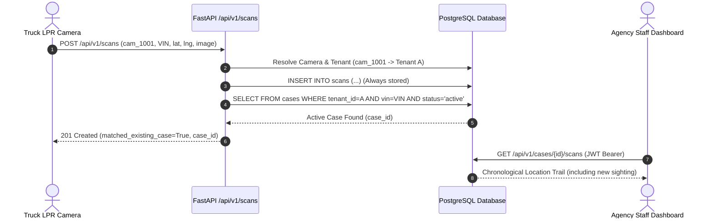
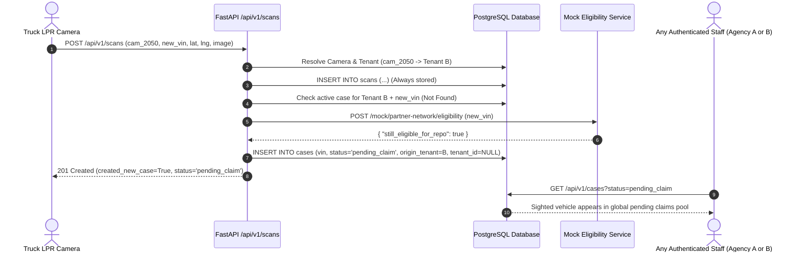
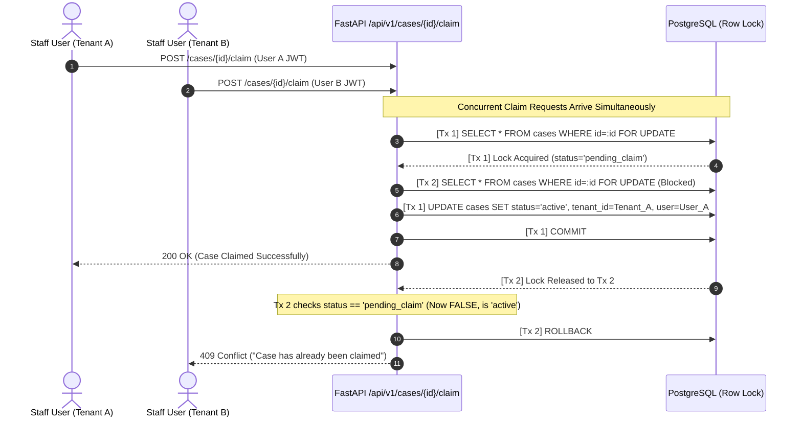

# System Architecture & Flow Specifications

## 1. Flow Diagrams

### Flow A: Inbound Scan Matches Existing Active Case

---

### Flow B: Inbound Scan Creates New Repossession Opportunity

---

### Cross-Tenant Claiming & Race Condition Defense

