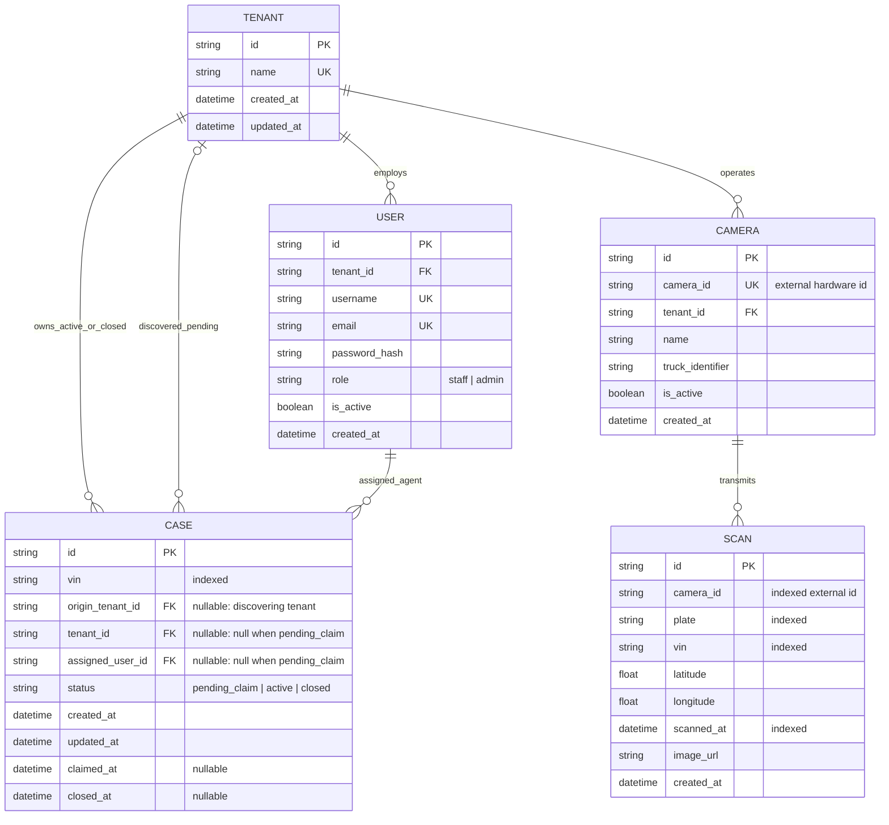

# Design Note: Plate Scan & Case Matching Service

## 1. Architectural Overview

The **Plate Scan & Case Matching Service** is a multi-tenant platform built for the vehicle repossession industry. The architecture comprises two distinct communication channels:

```
[Truck LPR Cameras]
        │  (Simulated Webhook: POST /api/v1/scans - Unauthenticated)
        ▼
[FastAPI Ingestion Engine] ──────► [Mock Lender Partner Network]
        │                                 │ (Eligibility Check)
        ▼                                 ▼
   [PostgreSQL Database] ◄────────────────┘
        ▲
        │  (Authenticated REST API: JWT Bearer + Tenant Isolation)
        ▼
[React + TypeScript Dashboard] (Independent Agency Portals)
```

1. **Inbound Ingestion Pipeline**: Inbound scans represent physical vehicle sightings captured continuously by truck-mounted LPR cameras. This channel is high-throughput, low-latency, and unauthenticated at the HTTP level (the camera identifies itself via an external `camera_id` hardware token).
2. **Tenant Operations Dashboard**: An authenticated React SPA utilized by recovery agency staff and administrators to investigate case trails, monitor alerts, and claim unassigned repossession opportunities.

---

## 2. Entity-Relationship Model



### Key Schema Decisions:
- **Nullable Case Ownership (`tenant_id`)**: A `Case` entity has a nullable `tenant_id` and `assigned_user_id`. When created under `Flow B` (`pending_claim`), the case belongs to no tenant. It records `origin_tenant_id` strictly for attribution and auditing.
- **Permanent Scan Retention**: Scans have no cascade delete links to cases. Even if a vehicle has no active repo order today, historical sightings are permanently preserved. When a lender files a repossession order in the future, the platform immediately surfaces the vehicle's historical location trail.
- **Partial Unique Constraint**:
  ```sql
  CREATE UNIQUE INDEX uq_tenant_active_vin ON cases (tenant_id, vin) WHERE status = 'active';
  ```
  Prevents any agency from possessing duplicate active cases for the exact same VIN while allowing historical closed cases and unassigned pending cases.

---

## 3. Multi-Tenancy & Access Control

Tenant boundaries are strictly enforced at the backend service and repository levels:
1. **JWT Authority**: The frontend never supplies a `tenant_id` in requests. The user's tenant identity is cryptographically signed into the JWT during authentication and extracted via FastAPI's `get_current_user` dependency.
2. **Query Scoping**: All queries for private cases, scans, and cameras inject tenant constraints:
   ```python
   # Base query for case discovery
   base_condition = or_(
       Case.tenant_id == current_user.tenant_id,
       Case.status == "pending_claim",
   )
   ```
3. **Data Leakage Prevention**: If a staff member from Agency A attempts to retrieve case details or scan trails for Agency B's active or closed case (e.g., `GET /api/v1/cases/{agency_b_case_id}/scans`), the service rejects the request with `HTTP 403 Forbidden` rather than returning partial records.

---

## 4. The Pending Claim Exception

The assignment specifies a deliberate exception to strict tenant boundaries:
- When a truck camera encounters an eligible vehicle without an existing active case, a `pending_claim` case is spawned into a global broker pool.
- **Business Rationale**: In repossession networks, forwarders and lenders broadcast eligible repossession orders to multiple qualified agencies. The first agency whose truck sights the vehicle or whose staff locks the recovery contract secures the assignment.
- **Access Rule**: All authenticated staff across all tenants can discover and inspect pending cases. However, once claimed, the case status immediately transitions to `active`, locking `tenant_id` to the claiming agency and removing it from all other tenants' visibility.

---

## 5. Concurrency & Race Condition Defense

When multiple agency dispatchers attempt to claim the same high-value pending case simultaneously, a race condition occurs.

### The Locking Protocol:
```
User A (Agency 1)                     User B (Agency 2)
      │                                     │
      ├─ POST /cases/{id}/claim             ├─ POST /cases/{id}/claim
      │                                     │
[BEGIN TRANSACTION]                   [BEGIN TRANSACTION]
      │                                     │
SELECT * FROM cases                   SELECT * FROM cases
WHERE id = :id FOR UPDATE;            WHERE id = :id FOR UPDATE;  ───► [BLOCKED ON ROW LOCK]
      │                                                                        │
Check status == 'pending_claim' (OK)                                           │
UPDATE status = 'active',                                                      │
       tenant_id = UserA.tenant_id,                                            │
       assigned_user_id = UserA.id                                             │
      │                                                                        │
COMMIT; ─────────────────────────────────────────────────────────────► [LOCK RELEASED]
      │                                                                        │
Return 200 OK                                                        Check status == 'pending_claim'
                                                                     (FAIL: status is 'active')
                                                                               │
                                                                     ROLLBACK;
                                                                               │
                                                                     Return 409 Conflict:
                                                                     "Case has already been claimed"
```

1. **Transaction Isolation**: `CaseService.claim_case` initiates a database transaction with `SELECT ... FOR UPDATE`.
2. **Atomic Verification**: The transaction re-evaluates `case.status == 'pending_claim'`.
3. **Deterministic Conflict**: The first user commits the ownership change. The second user acquires the lock only after commit, observes `status == 'active'`, and is returned `HTTP 409 Conflict`.

---

## 6. AWS Production Deployment Architecture

```
                                  [Route 53 DNS]
                                         │
                                   [CloudFront]
                                   /          \
                       (Static Assets)      (API Calls /api/*, /mock/*)
                             ▼                          ▼
                       [S3 Bucket]          [Application Load Balancer]
                      (React SPA)                       │
                                           ┌────────────┴────────────┐
                                           ▼                         ▼
                                   [ECS Fargate Task]        [ECS Fargate Task]
                                   (FastAPI Container)       (FastAPI Container)
                                           │                         │
                                           └────────────┬────────────┘
                                                        │
                                    ┌───────────────────┴───────────────────┐
                                    ▼                                       ▼
                       [Amazon RDS PostgreSQL]                    [Amazon ElastiCache]
                         (Multi-AZ Private)                         (Redis Cluster)
```

- **Edge Tier**: CloudFront CDN serves cached React frontend assets stored in an S3 bucket and routes dynamic API requests to the Application Load Balancer.
- **Compute Tier**: Amazon ECS on AWS Fargate runs stateless FastAPI containers inside private application subnets across multiple Availability Zones with Auto Scaling based on CPU and request latency.
- **Data Tier**: Amazon RDS PostgreSQL deployed in Multi-AZ configuration within isolated private subnets, accompanied by automated backups and read replicas.
- **Security & Secrets**: AWS Secrets Manager provisions database credentials and JWT signing keys injected via IAM Task Execution Roles. AWS WAF protects inbound camera webhook routes against DDoS attacks.

---

## 7. Scaling to Millions of Scans

At enterprise scale (10,000+ trucks transmitting hundreds of plate scans per minute):
1. **Asynchronous Ingestion via Amazon SQS / Apache Kafka**:
   Instead of synchronous database writes during webhook delivery, `POST /api/v1/scans` pushes payloads into an SQS FIFO Queue and immediately returns `202 Accepted` to the camera truck within 10ms.
2. **Worker Scaling**: ECS worker consumers dequeue scan batches, perform bulk database inserts, and evaluate matching rules asynchronously.
3. **Read Replicas & Redis Caching**:
   - Cache camera status (`camera_id -> tenant_id, is_active`) in ElastiCache Redis (sub-millisecond resolution).
   - Route dashboard reads and location trail history queries to RDS PostgreSQL Read Replicas.
4. **Table Partitioning**:
   Partition the `scans` PostgreSQL table by month (`RANGE (scanned_at)`) or hash by VIN to optimize vacuuming, indexing, and time-series pruning.
