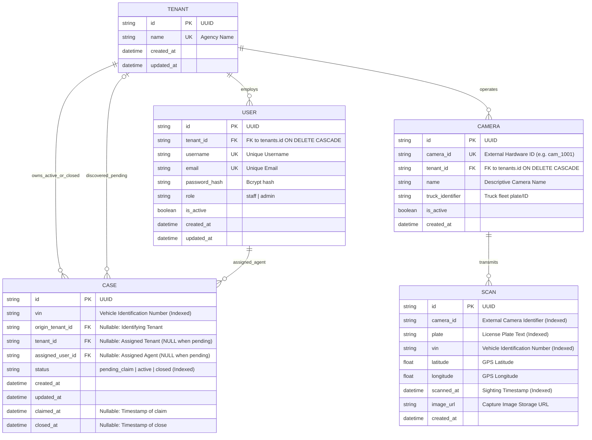

# Database Entity-Relationship (ER) Diagram & Schema Specification

## 1. Mermaid Entity-Relationship Diagram



---

## 2. Key PostgreSQL Constraints & Performance Indexes

### Partial Unique Index on Active Cases
Ensures an agency cannot accidentally create or claim duplicate active cases for the exact same VIN:
```sql
CREATE UNIQUE INDEX uq_tenant_active_vin ON cases (tenant_id, vin) WHERE status = 'active';
```

### Composite Ingestion Index
Optimizes Flow A lookup (`tenant_id` + `vin` + `status='active'`) during scan webhooks:
```sql
CREATE INDEX ix_case_tenant_vin_status ON cases (tenant_id, vin, status);
```

### Chronological Location Trail Index
Accelerates retrieval of the vehicle's sighting history ordered by time:
```sql
CREATE INDEX ix_scans_vin_scanned_at ON scans (vin, scanned_at);
```
